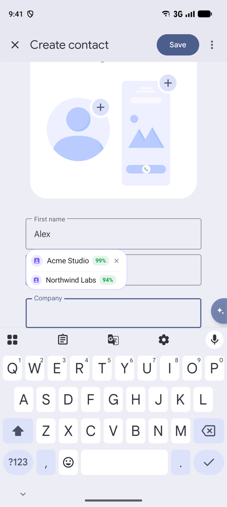
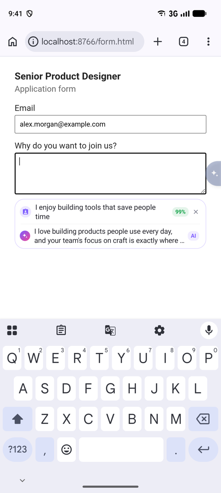
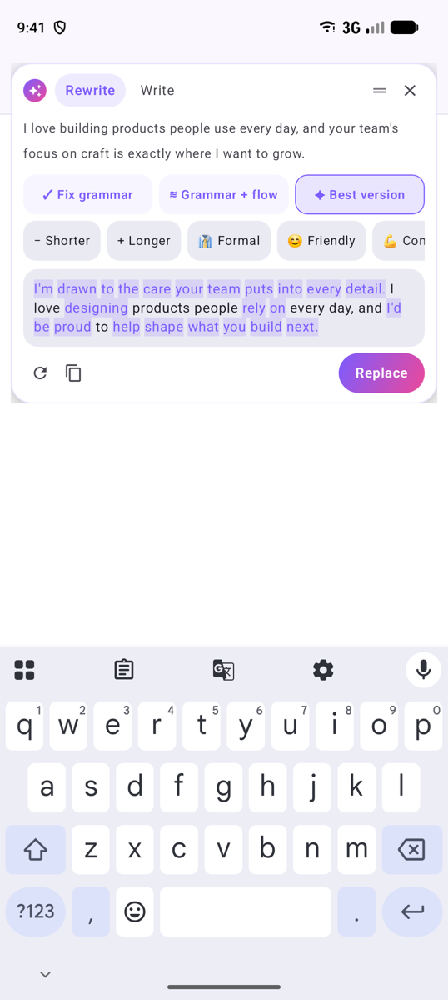
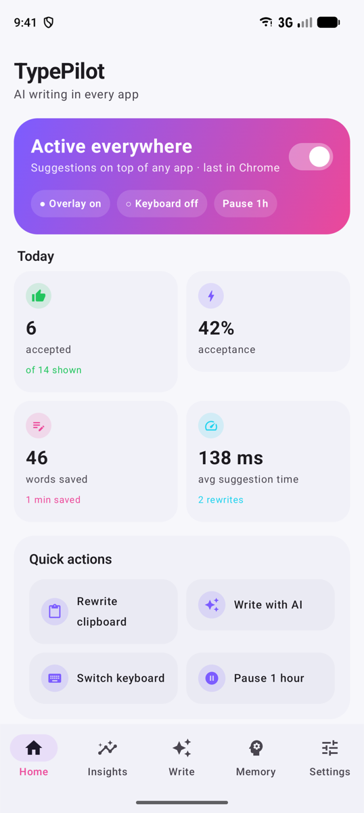
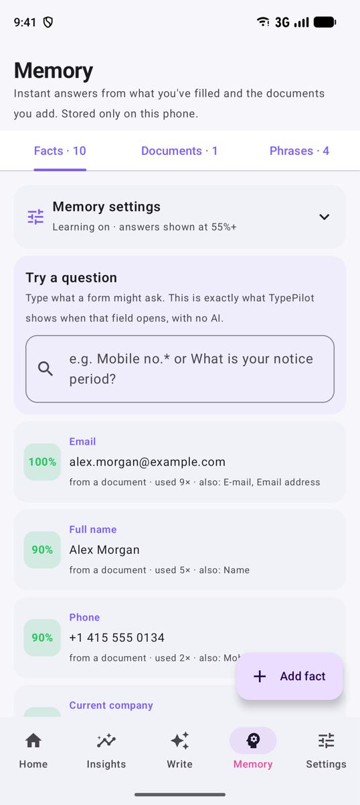
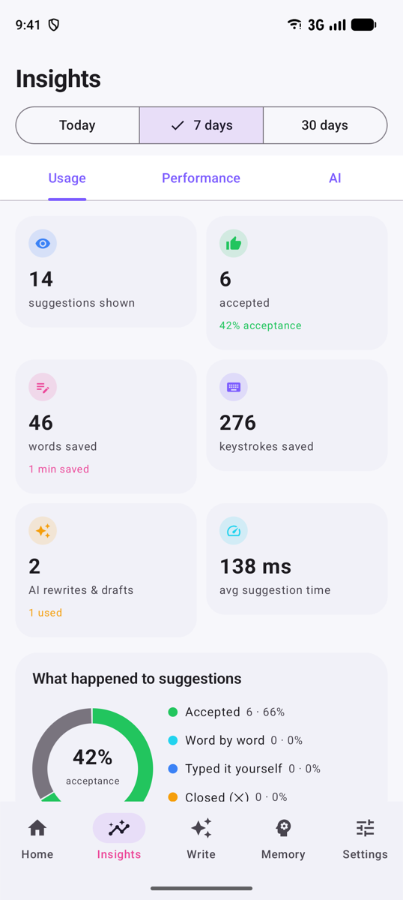

<div align="center">


# TypePilot

**AI that types with you, in every app.**<br>
Instant answers from your own memory, AI suggestions as you type, and one-tap rewrites,<br>on top of any app and with the keyboard you already use.

[](https://github.com/Naman503/typepilot/actions/workflows/ci.yml)
[](https://github.com/Naman503/typepilot/releases)
[](https://github.com/Naman503/typepilot/releases)


[](LICENSE)

<br>

## ⬇️ Download

<a href="https://github.com/Naman503/typepilot/releases/latest/download/TypePilot.apk"></a>
&nbsp;
<a href="https://apps.obtainium.imranr.dev/redirect?r=obtainium://app/%7B%22id%22%3A%22com.typepilot.android%22%2C%22url%22%3A%22https%3A%2F%2Fgithub.com%2FNaman503%2Ftypepilot%22%2C%22author%22%3A%22Naman503%22%2C%22name%22%3A%22TypePilot%22%7D"></a>

[](https://github.com/Naman503/typepilot/releases/latest/download/TypePilot.apk)

<sub>**TypePilot.apk** · about 34 MB · Android 9+ · arm64 · signed release build · [all versions & checksums](https://github.com/Naman503/typepilot/releases)</sub>

<br>


&nbsp;

&nbsp;


</div>

---

## 🚀 Install in 5 steps

| | Step | Where |
|:-:|---|---|
| **1** | **Download and open** `TypePilot.apk`. Allow your browser to install apps when asked. Play Protect may warn about an unknown developer: **More details → Install anyway**. | the badge above |
| **2** | **Open TypePilot once**, then **Home → Setup → Turn on TypePilot in Accessibility** and switch on *TypePilot AI suggestions*.<br><sub>Switch greyed out? App info → **⋮ → Allow restricted settings**, then try again.</sub> | TypePilot app |
| **3** | **Allow background running** so the phone doesn't stop it (setup card → **Set up**). | TypePilot app |
| **4** | **Connect an AI model:** Settings → AI. A free [Gemini key](https://aistudio.google.com), a Groq key, Ollama on your computer, or an on-device model. Memory answers work without any of these. | TypePilot app |
| **5** | **Tap any text field** in any app. The ✦ tab slides in from the edge and suggestions appear as soon as the keyboard opens. 🎉 | any app |

<sub>Vivo / iQOO, Xiaomi, Oppo, Samsung and others kill background apps. See [Keep it running](android/README.md#setup-on-the-phone) for the one extra switch your phone needs.</sub>

> **Updating from a build you made yourself?** Releases are signed with their own key, so Android needs one uninstall first. Save your memory first with **Settings → Apps, memory & privacy → Back up**, then **Restore** it after installing.

## 📑 Contents

[Why](#-why) · [Screenshots](#-screenshots) · [Highlights](#-highlights) · [How memory works](#-how-memory-works) · [AI models](#-ai-models) · [Payment apps](#-payment-and-banking-apps) · [Privacy](#-privacy) · [Permissions](#-permissions) · [Mac app](#-mac-app) · [Build](#-build-from-source) · [Full feature guide](android/README.md)

## 💡 Why

You type the same things all day: your name, email and company into forms, "on my way" and "sounds good" into chats, the same answers into every job application. And when it matters, you want the message to read well.

- **Keyboards guess the next word, not your answer.** They don't know your notice period, your current company or what you told the last recruiter.
- **AI apps are a copy-paste away.** Switching apps to ask a chatbot breaks your flow, and its answer doesn't know the form you're filling.
- **Autofill only knows a few field types.** Real forms ask questions in sentences.

TypePilot sits on top of every app, reads the question the field is asking, and answers from what *you've* written before and the documents you give it. AI fills the gaps.

## 📸 Screenshots

<div align="center">

| Home | Memory | Insights |
|:-:|:-:|:-:|
|  |  |  |

<sub>Screenshots use made-up demo data on a Pixel 9 Pro emulator.</sub>

</div>

## ✨ Highlights

| | |
|---|---|
| 🧠 **Answers from your memory** | Every field you fill is remembered as *question → answer*. Add your resume (PDF, Word or text) and it becomes facts. A field opens and the answer is there in milliseconds, with no AI call. |
| 🎯 **More than one likely answer** | Two companies? Old and new phone numbers? You see each one on its own row with a **% pill** for how sure TypePilot is. Tap the right one. |
| ✦ **Memory + AI, side by side** | For real questions ("Why do you want to join us?") an AI answer is written under your saved answers, the same way [FormPilot](https://github.com/Naman503/ai-personal-assistant-projects/tree/main/formpilot) fills web forms. |
| ⌨️ **Keep your keyboard** | Works with Gboard, SwiftKey, Samsung and others. There's also an optional TypePilot keyboard for phones where accessibility apps are blocked. |
| ✍️ **Rewrite in one tap** | **Fix grammar**, **Grammar + flow** or **Best version**, plus Shorter, Longer, Formal, Friendly, Hindi, Hinglish and your own instruction. Changed words are highlighted. |
| 📱 **Feels like part of Android** | A translucent edge tab in your Material You colour that slides in and fades. Rewrite from the text-selection menu, the share sheet or the Quick Settings tile. |
| 🪙 **No wasted tokens** | Nothing is looked up or sent until the keyboard is on screen. Memory and the cache answer first, and a keystroke cancels a pending request. |
| 🏦 **Safe with payment apps** | Mark UPI, banking and trading apps **Hidden**: accessibility switches fully off while they're open and comes back when you leave. |
| 📊 **Honest numbers** | Acceptance, words and time saved, and live CPU, memory and latency for every stage, all measured on the phone. |
| 🔒 **Private by design** | Never reads password, OTP, PIN or card fields. Memory stays on the phone, sensitive numbers are removed before anything goes to a cloud model, and on-device models work fully offline. |

## 🧠 How memory works

- **What's learned:** what you type into form fields (as *question → answer*), sentences you write often, and corrections you make to answers TypePilot filled in. Each one can be switched off in **Memory settings**.
- **Documents:** a quick offline pass picks out emails, phones, links and "Label: value" lines, then the AI turns the rest into facts with aliases ("Organisation" = "Company").
- **The %** is *match × trust*. Match is how well the fact fits the field's question. Trust grows each time you use an answer and drops when you close it. Answers below your threshold (55% by default) aren't shown.
- **App-aware:** something you typed in WhatsApp ranks first in WhatsApp. Turn on **Only in the app I typed it** to keep it there.
- **Try a question** (Memory → Facts) shows exactly what a field would get, and why.
- **Backup:** Settings → Apps, memory & privacy → **Back up** saves everything to one file (API keys are never included). **Restore** brings it back on a new phone.

More detail: [the full feature guide](android/README.md#knowledge-memory-instant-answers-without-ai).

## 🤖 AI models

| Provider | Cost | Notes |
|---|---|---|
| **Gemini** (default) | Free key | `gemini-3.5-flash-lite`: about 1 s to the first word on a mid-range phone. |
| **Groq / OpenRouter / any OpenAI-compatible API** | Free tiers | Groq is the fastest cloud option. |
| **Ollama** on your computer | Free | **Find Ollama on Wi-Fi** finds it and lists its models. |
| **On-device** (LiteRT-LM) | Free, offline | 18 curated models (Gemma, Qwen3, LFM2.5, SmolLM…), each rated for *your* phone's chip and RAM, with a built-in benchmark. |
| **Memory only** | Free | No AI at all: memory, phrases and shortcuts. |

You can use different models for suggestions and for rewriting.

## 🏦 Payment and banking apps

Many payment, UPI and banking apps refuse to run while an accessibility app is on. Mark them **Hidden** in *Where TypePilot works* (they're detected and listed first). TypePilot then switches its accessibility service fully off while that app is open and back on within a few seconds of leaving it.

This needs **Usage access** (asked in the app) and one command from a computer, once:

```bash
adb shell pm grant com.typepilot.android android.permission.WRITE_SECURE_SETTINGS
```

If the phone kills the watcher while accessibility is off, the next app update, reboot, backup alarm or app start turns it back on.

## 🔒 Privacy

- **Never reads password fields**, or fields labelled PIN, OTP, CVV, card, Aadhaar, PAN and similar. Password managers are excluded by default.
- **Never learns** OTPs, card numbers, keys or ID numbers.
- **Your memory and stats stay on the phone.** The only text that leaves it is what a cloud model needs, and only when you choose a cloud model.
- **Anonymous usage, with an off switch.** TypePilot shares which features are used, daily counts (suggestions shown and accepted), setup steps, the AI provider *type* and crashes (exception type and stack, never the message), tied to a random id made on first run. Never what you type, your memory, app names, model hosts or keys. Turn it off in **Settings → Apps, memory & privacy → Share anonymous usage**; that also deletes what was sent.
- **Redacted first:** card numbers, keys, IBAN, Aadhaar, PAN and SSN are removed before text goes to a cloud model.
- **API keys** are encrypted with an Android Keystore key and never leave the phone, not even in backups.
- The app shows Google Play's **prominent disclosure** before you turn on the accessibility service.

## 🔑 Permissions

| Permission | Why |
|---|---|
| **Accessibility service** | Reads the focused field and the text around it, shows suggestions over the app and inserts what you pick. |
| **Internet** | Cloud models (Gemini, Groq, Ollama…) and model downloads. Not needed for memory or on-device models. |
| **Usage access** (optional) | Tells the smart switch which app is open, for Hidden apps. |
| **Write secure settings** (optional, via adb) | Lets the smart switch turn accessibility off and on for Hidden apps. |
| **Notifications, foreground service** | The small watcher that runs only while a Hidden app is open. |
| **Run at boot** | Makes sure accessibility is back on after a reboot. |

## 🍎 Mac app

TypePilot also runs on macOS 14+ as a menu-bar app: suggestions in every text field, **⌥ Space** to write with AI, memory and text shortcuts. It uses Apple's on-device model by default (macOS 26 with Apple Intelligence), with Ollama, Gemini and OpenAI-compatible APIs as options.

It's built from source for now: see [mac/README.md](mac/README.md).

## 🛠 Build from source

**Android:** JDK 17 and the Android SDK (platform 37 downloads automatically).

```bash
cd android
./gradlew :app:testDebugUnitTest :app:assembleDebug
```

The APK is at `android/app/build/outputs/apk/debug/app-debug.apk`. A release build without a signing key falls back to the debug key, so it works on any machine; don't publish those.

**Mac:** Xcode 16+ (Swift 6).

```bash
cd mac
swift test && ./scripts/build-app.sh
```

**Releases:** bump `versionName` and `versionCode` in `android/app/build.gradle.kts`, add `docs/releases/vX.Y.Z.md`, then push the tag `vX.Y.Z`. The [release workflow](.github/workflows/release.yml) runs the tests, builds the APK signed with the release key from the repository secrets, checks it isn't debug-signed, and publishes `TypePilot.apk` with its SHA-256 checksum.

### Project layout

```
typepilot/
├── android/            Android app (Kotlin, Jetpack Compose): overlay, keyboard, memory, models
│   └── README.md       full feature guide, performance notes, code map
├── mac/                macOS menu-bar app (Swift, AppKit)
├── docs/
│   ├── FEASIBILITY.md        what each platform allows, which models are fast enough
│   ├── ANDROID_RESEARCH.md   overlay vs keyboard, battery, latency, Play policy
│   ├── images/               icon and screenshots
│   └── releases/             release notes, one file per version
└── .github/workflows/  ci.yml (tests + builds on every push), release.yml (signed APK on tags)
```

**Stack:** Kotlin 2.4 · Jetpack Compose (Material 3) · OkHttp 5 · LiteRT-LM · PdfBox · SQLite · Swift 6 / AppKit.

## 📄 License

[MIT](LICENSE) © 2026 Naman
